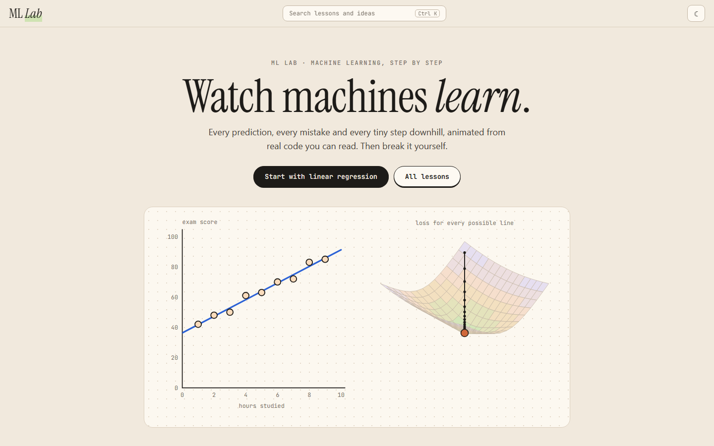
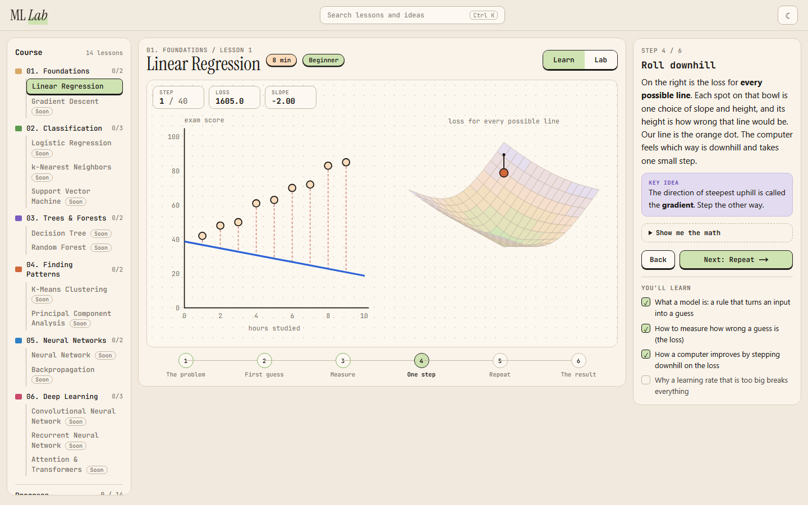
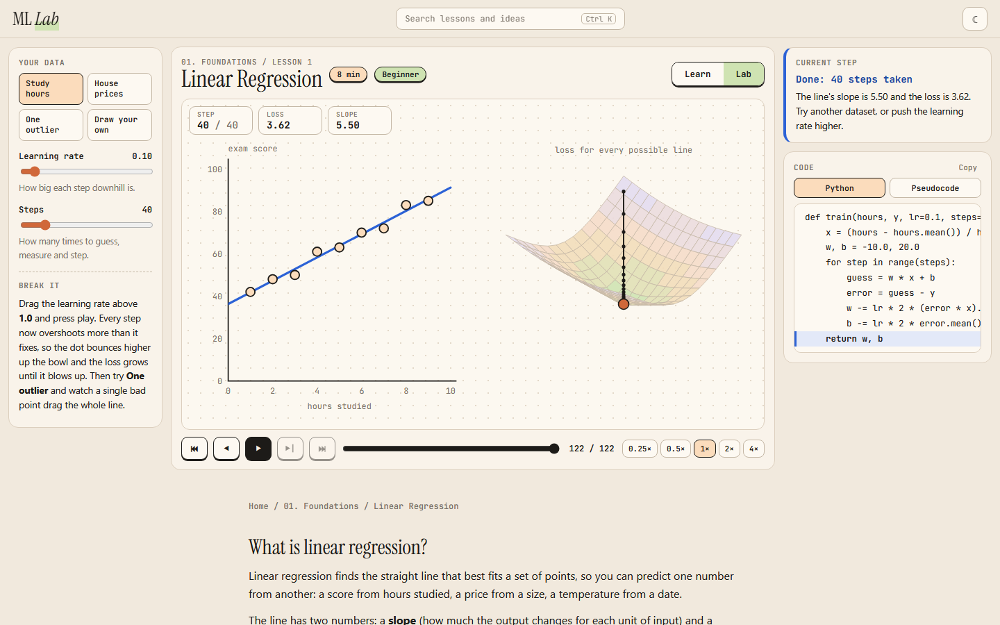
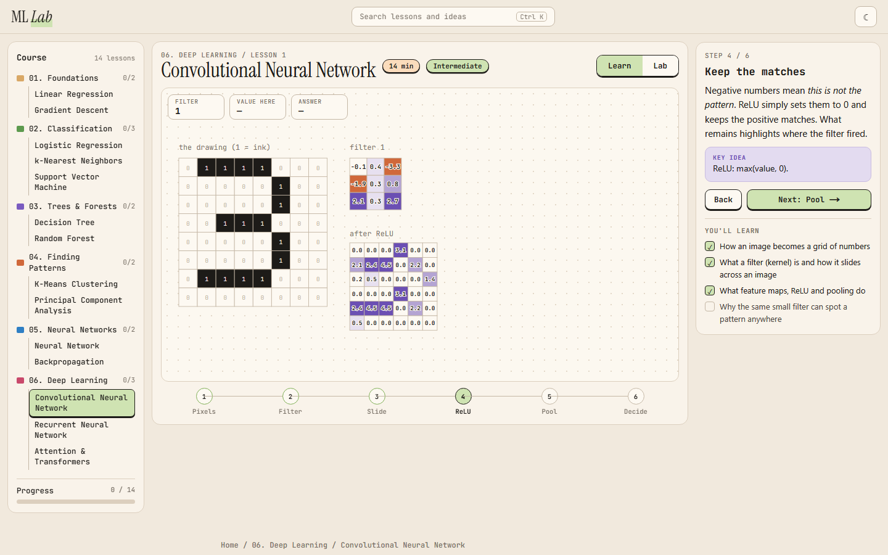
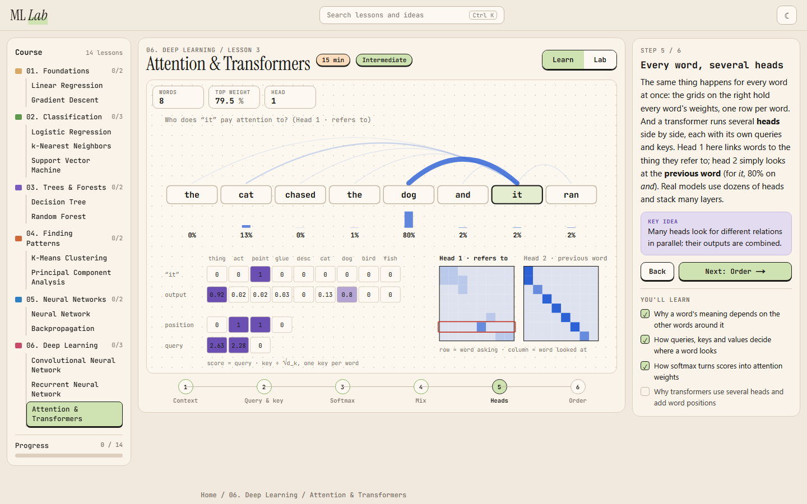
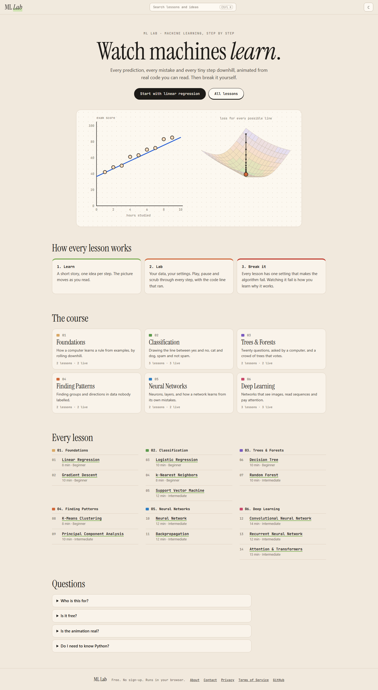

# ML Lab



**Watch machines learn.** ML Lab is a free, interactive website that teaches machine learning and deep learning by letting students *watch algorithms work*, one step at a time, and then experiment with them.

Every lesson runs the real algorithm on real numbers, right in the browser, records every step, and replays it as an animation next to the code that produced it. There are no videos, no accounts and no servers: just open a lesson and start learning.

## What is it for?

ML Lab is built for **students** who want to understand machine learning, not just call a library. It assumes only school algebra. Each idea is explained in plain words first, with the math folded away until you want it.

Use it to:

- **Learn** how a model learns: what a loss is, why gradient descent works, what a neural network actually computes.
- **Experiment** with your own data and settings and see what changes.
- **Break things on purpose:** every lesson has one setting that makes the algorithm fail, so you see *why* it works when it does.
- **Teach:** share a link to an exact step of a lesson (for example `/lessons/linear-regression/#step-4`) with a class.

## Screenshots

**Learn mode:** a guided story, one idea per step, while the picture moves.



**Lab mode:** your data, your settings, a player, and the line of code that just ran.



**Deep learning, too:** a convolutional network reading a drawn digit, and self-attention linking "it" to the word it refers to.





<details>
<summary><b>The whole home page</b></summary>



</details>

## Features

- **Learn mode:** a short guided story per lesson, one idea per step, with a key idea box, optional math, a step rail and Back/Next navigation.
- **Lab mode:** the same animation with your own controls:
  - dataset presets, or draw your own points by clicking or typing
  - hyperparameter sliders (learning rate, steps, …)
  - a player with play/pause, step forward/back, a scrubber and speeds from 0.25× to 4×
  - a code panel in **Python** and **pseudocode** with the line that just ran highlighted
- **Real algorithms, not canned videos:** each algorithm is a pure TypeScript function that records a trace of frames; the picture is a replay of that trace. The math is tested against NumPy. The convolutional and recurrent networks use small weights trained offline with NumPy (the browser recomputes every activation from them), and the attention lesson uses hand-set weights, stated openly in the lesson.
- **"Break it" moments:** every lesson shows a failure on purpose (for example, a learning rate that is too big blows up training).
- **Course structure:** 14 lessons in 6 chapters, all live:

  | Chapter | Lessons |
  |---|---|
  | 01 Foundations | Linear Regression, Gradient Descent |
  | 02 Classification | Logistic Regression, k-Nearest Neighbors, Support Vector Machine |
  | 03 Trees & Forests | Decision Tree, Random Forest |
  | 04 Finding Patterns | K-Means Clustering, Principal Component Analysis |
  | 05 Neural Networks | Neural Network, Backpropagation |
  | 06 Deep Learning | Convolutional Neural Network, Recurrent Neural Network, Attention & Transformers |
- **Progress tracking** saved in your own browser; no sign-up.
- **Shareable links** to any step or to the Lab (`#step-3`, `#lab`).
- **Light and dark themes**, keyboard shortcuts (←/→, Space, R, L), screen-reader friendly, and a phone layout.
- **Fast and static:** every lesson is a pre-rendered page that search engines can index; every lesson page ships under 200 KB of JavaScript.
- **Ready for translation:** all text lives in JSON files under `content/`, and the CSS supports right-to-left languages.

## Getting Started

### Prerequisites

- [Node.js](https://nodejs.org/) 20 or newer (developed on Node 22)
- npm (comes with Node.js)
- Optional: Python 3 with NumPy, only to regenerate the test fixtures and trained weights in `tools/`

### Install and run

```bash
git clone https://github.com/bashar0101/ml-lab.git
cd ml-lab
npm install
npm run dev
```

Open [http://localhost:3000](http://localhost:3000) in your browser.

### Useful commands

| Command | What it does |
|---|---|
| `npm run dev` | Start the development server |
| `npm test` | Run the unit and component tests (Vitest) |
| `npm run build` | Build the static site into `out/` |
| `npx serve out -l 3100` | Preview the built site at http://localhost:3100 |
| `npm run e2e` | Run the browser tests (Playwright) against `out/`; run `npx playwright install chromium` once first |
| `npm run budget` | Check the lesson page stays under 200 KB of gzipped JavaScript |
| `npm run lint` | Lint the code (ESLint) |
| `python tools/fixtures/<lesson>.py` | Regenerate a lesson's NumPy reference results (for example `linear_regression.py`) |
| `python tools/train/digits.py` | Retrain the small CNN on generated digits and rewrite its weights |
| `python tools/train/rnn.py` | Retrain the small RNN and rewrite its weights |

### Deploying

`npm run build` produces a fully static site in `out/`. Upload that folder to any static host (Vercel, Netlify, GitHub Pages, Cloudflare Pages, …). Set `NEXT_PUBLIC_SITE_URL` to your domain when building so the sitemap and canonical links are correct.

## Project Structure

```
ml-lab/
├── content/en/              # All text: UI strings and one JSON file per lesson
│   ├── ui.json
│   └── lessons/             # linear-regression.json … attention-transformers.json
├── e2e/                     # Playwright browser tests
├── scripts/                 # Build helpers (JS budget check, export fix)
├── tools/fixtures/          # NumPy scripts that produce reference results
├── tools/train/             # NumPy scripts that train the CNN and RNN weights
├── src/
│   ├── app/                 # Next.js pages: home, lessons/[slug], about, privacy, terms, sitemap
│   ├── components/          # Top bar, footer, article, home page parts
│   │   └── workspace/       # The lesson workspace: Learn/Lab, player, story card, code panel
│   ├── content/             # Content schema (zod) and loaders
│   ├── course/manifest.ts   # Chapters and lessons, their order and status
│   ├── engine/              # Trace engine: frames, seeded random numbers, text helpers
│   ├── i18n/                # UI string lookup
│   ├── lessons/             # One folder per lesson: algorithm, scene, controls, code
│   │   ├── shared/          # Plot helpers, datasets, CART and MLP code shared by lessons
│   │   └── linear-regression/ … attention-transformers/
│   ├── state/               # Player, deep links, progress, keyboard, theme
│   └── styles/              # Design tokens and global CSS
└── docs/superpowers/        # Design spec and implementation plans
```

### Adding a lesson

1. Create `src/lessons/<slug>/` with an algorithm that returns a trace, a `Scene`, `LabControls` and the code lines, and register it in `src/lessons/registry.ts`.
2. Write `content/en/lessons/<slug>.json` (story, events, lab text, article).
3. Set the lesson's status to `"live"` in `src/course/manifest.ts`.

The content contract tests check that every story step, event and stat in the new lesson has matching text.

## Built With

- [Next.js 16](https://nextjs.org/) (App Router, static export) and [React 19](https://react.dev/)
- [TypeScript](https://www.typescriptlang.org/)
- CSS Modules with CSS variables (no CSS framework)
- [Zod](https://zod.dev/) for content validation
- SVG for all animations and diagrams
- [JetBrains Mono](https://www.jetbrains.com/lp/mono/) and [Instrument Serif](https://fonts.google.com/specimen/Instrument+Serif) fonts
- [Vitest](https://vitest.dev/) and [Testing Library](https://testing-library.com/) for unit and component tests
- [Playwright](https://playwright.dev/) for browser tests
- [NumPy](https://numpy.org/) for reference results that the algorithms are tested against

## License

This project is licensed under the MIT License. See the [LICENSE](LICENSE) file for details.
